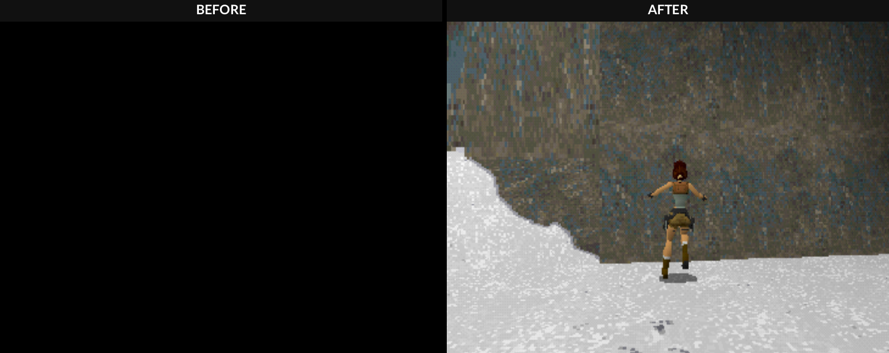
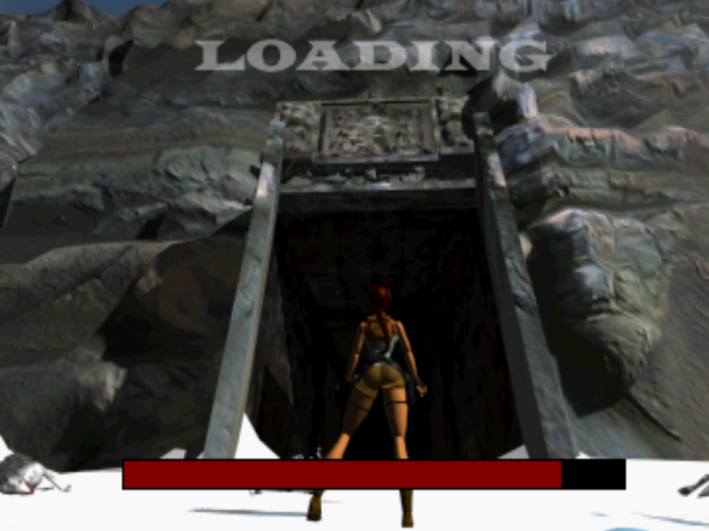
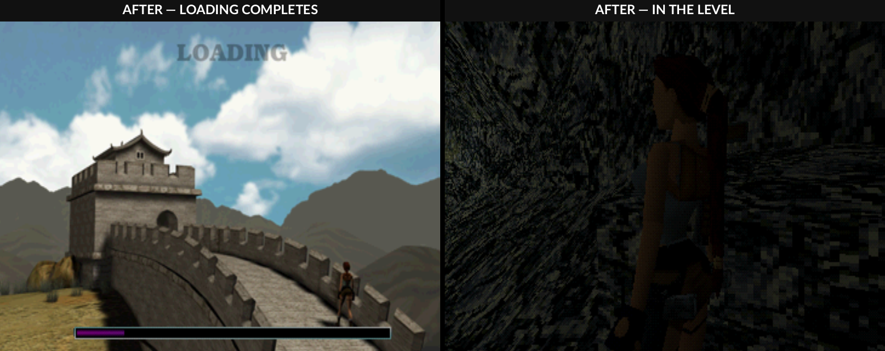
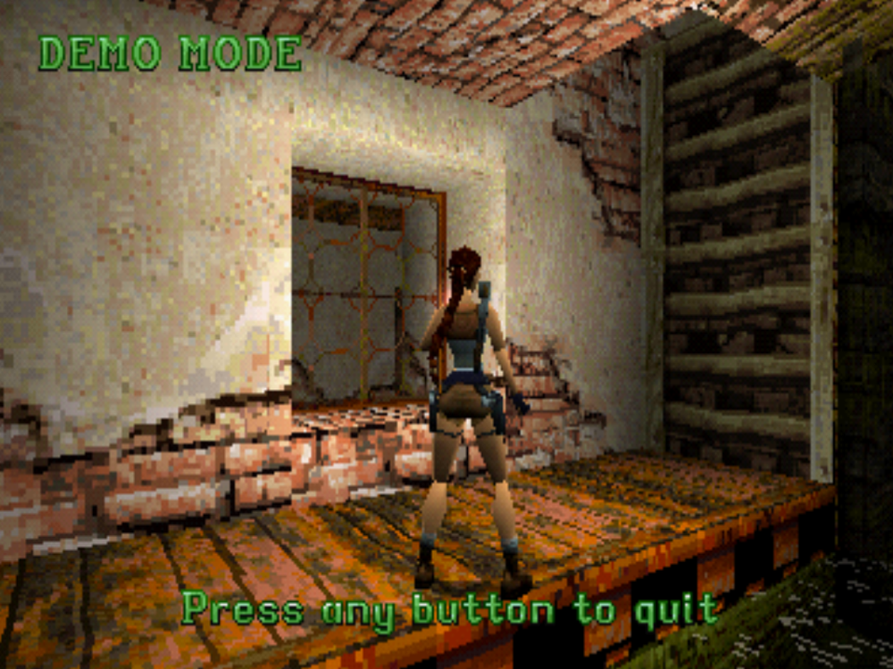
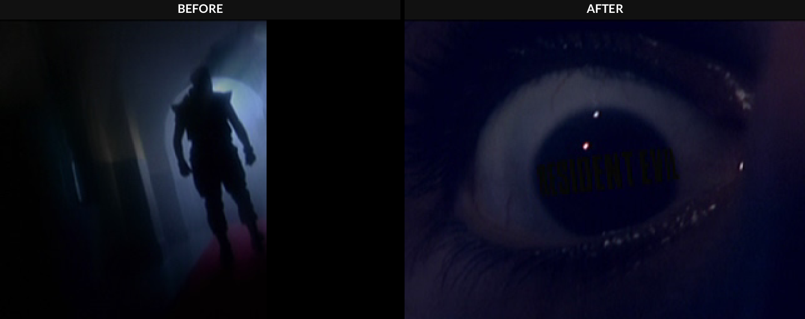
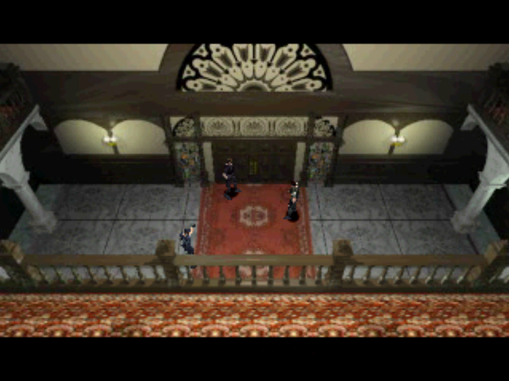
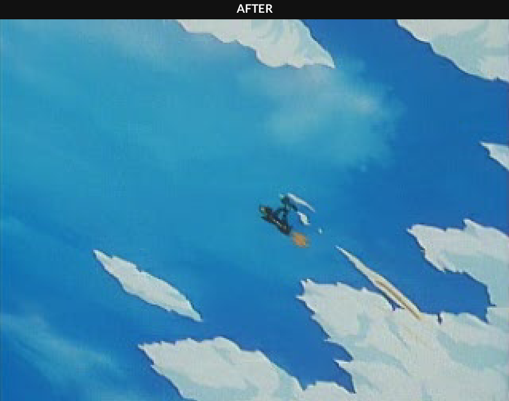
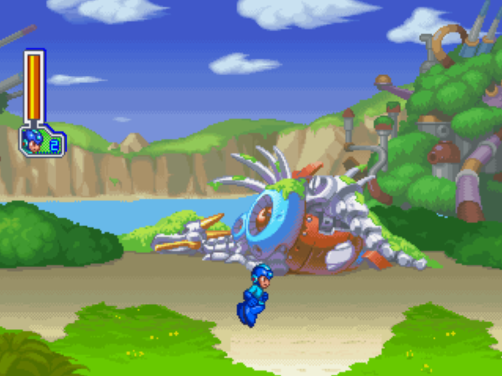

# Recomp Tools

A friendly front-end for the PSXRecomp pipeline: pick PS1 discs, probe
them, tick the house-rule options, and convert — one game at a time —
into packaged native PC recomps (Linux + Windows), with the launcher
UI and RetroAchievements wired in.

## Run it

- Linux: `./recomp-tools.sh` (or `.venv/bin/python app/main.py`)
- The engine also runs headless:
  - `.venv/bin/python app/engine.py toolbox`
  - `.venv/bin/python app/engine.py probe --cue "Game (USA).cue"`
  - `.venv/bin/python app/engine.py run --job job.json`

## What's inside

- `app/main.py` — the Qt window (Convert tab + Help tab).
- `app/engine.py` — the conversion pipeline (scaffold → probe → patch →
  RA wiring → emitters → generate → build → verify → package). The GUI
  and the CLI drive the same code.
- `bundle/ra/` — the RetroAchievements module (src_ra + rcheevos),
  copied into each new project when RA is enabled. Includes the login
  toast, the callback-polarity fix, pop-ups, and the
  `RA_DISABLE_POPUPS` build-time toggle.
- `art-cache/` — cover art fetched from libretro-thumbnails.

## Credits

- **PSXRecomp** — the static-recompilation framework this tool drives —
  created by **Matthew Stanley (mstan)**, now part of the
  [RetroPortingToolkit](https://retroportingtoolkit.com/)
  ([github.com/mstan](https://github.com/mstan),
  [github.com/RetroPortingToolKit](https://github.com/RetroPortingToolKit)).
  PSXRecomp is licensed under PolyForm Noncommercial 1.0.0.
  Recomp Tools does not redistribute PSXRecomp; it uses a copy from one
  of your own projects, with the framework's license intact.
- **recomp-ui** (the launcher in every converted game) —
  RetroPortingToolKit, MIT License, © 2026 Matthew Stanley.
- **rcheevos** (bundled in `bundle/ra/`) — RetroAchievements, MIT.
- **OpenBIOS** — the open-source BIOS bundled with PSXRecomp.
- Cover art: [libretro-thumbnails](https://thumbnails.libretro.com/).

## Fixed — before & after

Two runtime defects found in converted games are fixed in the engine,
with the frames to show it. Both fixes are framework patches the
engine applies to every new conversion; re-running an affected game
under the listed release picks the fix up.

### Tomb Raider 1 + 2 — black screen at level load (fixed in v1.0.16)

The runtime's CD GetlocP answer reported the wrong track position, so
both games waited forever at the load after a music-track seek:
permanent black screen, no audio. Left: the frame every TR1 load
landed on before the fix. Right: the same New Game load reaching the
Caves after it.

No pre-fix frame of Tomb Raider 2 was kept; it had the same defect
and got the same fix. Below is TR2 after the fix — the Great Wall
loading screen was its freeze point — plus the attract demo playing.

### Resident Evil: Director's Cut — cropped FMVs (fixed in v1.0.17)

Capcom's movie player uploads each frame as narrow vertical strips,
which the runtime's movie staging didn't count, so movies rendered
639 px wide in the 960-px window with the right third black. The
pair below is the live-action intro before and after — different
moments of the same movie; the width is the point.

### Mega Man 8 — same FMV crop (fixed in v1.0.17)

Mega Man 8 uses the same Capcom strip-upload pattern and is cured by
the same patch. No pre-fix frame of this game was kept, so only the
after is shown: the opening FMV at full width, and intro-stage
gameplay, from the v1.0.17 build.

## Changes

- **v1.0.17 (2026-11-05)** — FMV crop fix: the runtime's depth24
  (24-bit movie) upload-span tracker only counted CPU→VRAM uploads
  ≥256 halfwords wide, but Capcom's STR players upload each movie
  frame as narrow vertical strips (Resident Evil: Director's Cut:
  20 strips of 24×240), so a movie's true coverage never registered
  and the staging pass blacked out every frame past a stale 213-px
  limit — movies rendered ~2/3 width, hard against the left edge,
  while gameplay was full width. The engine now patches the
  framework's `gpu.c` in the template and in every scaffolded
  project: every upload counts toward the span while depth24 is on,
  and the staging blanks nothing at full coverage, otherwise exactly
  the uncovered tail (the narrow-blit stale-VRAM case the fill was
  built for still blanks its tail). Re-run an affected game here to
  pick up the fix; RE Director's Cut verified on camera (intro, logo
  and story FMVs full width). Mega Man 8 uses the same upload
  pattern and is cured by the same patch. Windows packages are
  compile-verified only, as before.

- **v1.0.16 (2026-11-05)** — CD position fix: the runtime's GetlocP
  answer for the not-playing drive hardcoded track 1, so games that
  confirm a seek into a CD music track before loading a level
  (Tomb Raider 1 + 2) hung on a black screen with no audio. The
  engine now patches the framework's `cdrom.c` in the template and
  in every scaffolded project: GetlocP reports the real containing
  track with hardware-correct pregap sub-Q. Re-run an affected game
  here to pick up the fix; TR1 + TR2 verified into gameplay.

## Notes

- Conversions run **one game at a time** on purpose: parallel Generate
  stages run out of RAM, and serial runs keep failures contained.
- The framework is copied from a *template project* (any finished
  recomp) when the online clone fails — pick one in the settings if
  auto-detect finds none.
- Windows `.exe` packaging needs PyInstaller on a Windows machine;
  the app itself is one cross-platform codebase.
